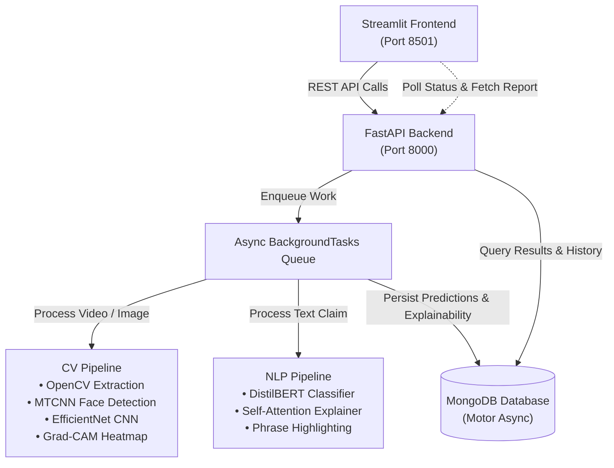

# 🔍 TruthLens — AI-Powered Deepfake & Misinformation Detection Platform

[](https://www.python.org/)
[](https://fastapi.tiangolo.com/)
[](https://streamlit.io/)
[](https://www.mongodb.com/)
[](https://www.docker.com/)

**TruthLens** is an end-to-end full-stack AI platform designed to detect deepfake media (video and images) and linguistic misinformation (fake news and viral claims). Built as a 6-person student capstone project, TruthLens prioritizes modularity, decoupled micro-pipelines, explainable AI (XAI), and asynchronous task execution.

---

## 🏛️ System Architecture



---

## 📁 Repository Structure

```
truthLensCapstone/
├── docker-compose.yml       # Multi-container orchestration (Backend + Frontend + MongoDB)
├── README.md                # Project documentation and quickstart
├── .gitignore               # Git ignore rules for virtual environments & model artifacts
│
├── frontend/                # Streamlit Web Application
│   ├── app.py               # Main Streamlit dashboard & router
│   ├── api_client.py        # REST API client for backend communication
│   ├── Dockerfile           # Frontend container configuration
│   ├── requirements.txt     # Frontend Python dependencies
│   ├── .env.example         # Frontend environment settings
│   └── components/
│       ├── auth.py          # Simple username-based session manager
│       ├── upload_widget.py # File upload & text input interfaces with polling
│       ├── results_view.py  # Results dashboard with Grad-CAM and phrase highlighting
│       └── history_table.py # Chronological scan history table
│
├── backend/                 # FastAPI REST API & Asynchronous Worker
│   ├── main.py              # Application entrypoint, CORS & static file mount
│   ├── database.py          # Motor async MongoDB client with in-memory fallback
│   ├── models.py            # Pydantic validation schemas
│   ├── Dockerfile           # Backend container configuration
│   ├── requirements.txt     # Backend Python dependencies
│   ├── .env.example         # Backend environment configuration
│   ├── routes/
│   │   ├── media.py         # POST /upload-media endpoint
│   │   ├── text.py          # POST /analyze-text endpoint
│   │   ├── results.py       # GET /results/{scan_id} endpoint
│   │   └── history.py       # GET /history/{user_id} endpoint
│   └── services/
│       └── task_queue.py    # Async BackgroundTasks CV & NLP inference workers
│
├── cv-pipeline/             # Computer Vision Deepfake Pipeline
│   ├── extractor.py         # OpenCV uniform frame sub-sampling (1 frame every N frames)
│   ├── face_detector.py     # MTCNN face detection & margin-padded cropping
│   ├── classifier.py        # CNN classifier (EfficientNet/Xception) & score aggregation
│   ├── gradcam.py           # Grad-CAM heatmap visualization overlaid on face
│   ├── pipeline.py          # End-to-end CVPipeline orchestrator
│   ├── README.md            # CV team guide for model fine-tuning & evaluation
│   └── requirements.txt     # CV dependencies (PyTorch, Torchvision, facenet-pytorch)
│
├── nlp-pipeline/            # Natural Language Processing Misinformation Pipeline
│   ├── preprocessor.py      # Text sanitization & span-preserving tokenization
│   ├── classifier.py        # DistilBERT / RoBERTa sequence classification
│   ├── explainer.py         # Multi-head attention extraction & HTML phrase highlighting
│   ├── pipeline.py          # End-to-end NLPPipeline orchestrator
│   ├── README.md            # NLP team guide for fine-tuning on LIAR / FakeNewsNet
│   └── requirements.txt     # NLP dependencies (Transformers, PyTorch, Scikit-learn)
│
└── docs/                    # Capstone Specifications & Guides
    ├── ARCHITECTURE.md      # Detailed system architecture, data flows & sequence diagrams
    ├── API_SPEC.md          # Complete REST API specification with sample payloads
    ├── CAPSTONE_GUIDE.md    # 6-person student team roles, git workflow & modular roadmap
    └── DEPLOYMENT.md        # Deployment instructions for local dev, Docker & cloud
```

---

## ⚡ Quickstart

### Option 1: Docker Compose (All-in-One)

Run the entire application stack (MongoDB, Backend, and Frontend) with a single command:

```bash
docker compose up --build
```

- **Streamlit Web UI:** [http://localhost:8501](http://localhost:8501)
- **FastAPI Backend:** [http://localhost:8000](http://localhost:8000)
- **Interactive API Docs (Swagger):** [http://localhost:8000/docs](http://localhost:8000/docs)
- **MongoDB Database:** `localhost:27017`

---

### Option 2: Local Development (Without Docker)

You can run the backend and frontend locally with native Python:

#### 1. Setup Virtual Environment
```bash
python -m venv venv

# Windows (PowerShell):
.\venv\Scripts\Activate.ps1

# macOS / Linux:
source venv/bin/activate
```

#### 2. Install Dependencies
```bash
pip install -r backend/requirements.txt
pip install -r frontend/requirements.txt
pip install -r cv-pipeline/requirements.txt
pip install -r nlp-pipeline/requirements.txt
```

#### 3. Start Backend Service
```bash
python -m uvicorn backend.main:app --host 0.0.0.0 --port 8000 --reload
```
> **Resilient Database:** If MongoDB is running locally, TruthLens connects to it. If MongoDB is offline, TruthLens automatically activates its **in-memory async storage fallback**, allowing team members to test the app without needing a local MongoDB service running!

#### 4. Start Frontend UI
```bash
streamlit run frontend/app.py --server.port 8501
```

---

## 🧪 Pipeline Details

### Computer Vision Pipeline (`/cv-pipeline`)
1. **Frame Sub-Sampling:** Extracts 1 frame every $N$ frames (default: 15) using OpenCV `cv2.VideoCapture`.
2. **Face Detection & Cropping:** Detects faces using MTCNN (`facenet-pytorch`) with a 20% margin padding to include the forehead, hairline, and jawline manipulation boundaries. Includes OpenCV Haar cascade fallback.
3. **CNN Deepfake Classifier:** Evaluates frames using an EfficientNet-B0 backbone for binary classification (`REAL` vs `FAKE`).
4. **Temporal Score Aggregation:** Combines mean fake probability with the top 30% most anomalous frames ($0.60 \times \text{Top-K} + 0.40 \times \text{Mean}$) to catch localized deepfake edits.
5. **Grad-CAM Explainability:** Computes gradients against the final convolutional layer to generate a high-contrast jet colormap heatmap overlaid on the most suspicious face.

### Natural Language Processing Pipeline (`/nlp-pipeline`)
1. **Text Preprocessing:** Cleans markup, normalizes whitespace, and extracts tokens while maintaining exact character span indices.
2. **Transformer Classification:** Evaluates claims using DistilBERT / RoBERTa for sequence classification (`CREDIBLE` vs `MISLEADING`).
3. **Self-Attention Explainability:** Extracts multi-head attention weights from the final Transformer layer to compute token importance scores.
4. **Visual Highlighting:** Renders inline HTML markup with color intensity reflecting phrase importance (coral red for sensationalism/misleading, emerald green for credibility markers).

---

## 🗄️ Database Collections (MongoDB)

| Collection | Schema Description |
| :--- | :--- |
| `users` | Stores `user_id`, `username`, `created_at`, `scan_count`. |
| `scans` | Stores `scan_id`, `user_id`, `scan_type`, `filename` / `text_claim`, `status` (`pending`, `processing`, `completed`, `failed`), timestamps. |
| `predictions` | Stores `prediction_id`, `scan_id`, `model_name`, `label`, `confidence`, `frame_scores`, `summary`. |
| `explainability_outputs` | Stores `prediction_id`, `scan_id`, `type`, `heatmap_url`, `highlighted_phrases`, `highlighted_html`, `token_importances`. |

---

## 👥 6-Person Student Capstone Collaboration

The repository is modularly decoupled so that each sub-team can work without blocking others:
- **Member 1 (Backend & DB):** Manages FastAPI, Motor MongoDB, and background task queues in `/backend`.
- **Member 2 (Frontend & UX):** Enhances Streamlit dashboards, charts, and session state in `/frontend`.
- **Member 3 (CV Preprocessing):** Optimizes video decoding and MTCNN face cropping in `/cv-pipeline`.
- **Member 4 (CV Modeling & Grad-CAM):** Fine-tunes EfficientNet/Xception weights and Grad-CAM in `/cv-pipeline`.
- **Member 5 (NLP Preprocessing & Model):** Fine-tunes DistilBERT/RoBERTa on fake news datasets in `/nlp-pipeline`.
- **Member 6 (NLP Explainability & QA):** Refines attention highlighting and benchmark testing in `/nlp-pipeline`.

See [docs/CAPSTONE_GUIDE.md](file:///c:/Users/hrish/OneDrive/Documents/truthLensCapstone/docs/CAPSTONE_GUIDE.md) for details on role assignments, weight substitution, and Git branching.

---

## 📄 License
This project is developed for academic capstone demonstration purposes.
