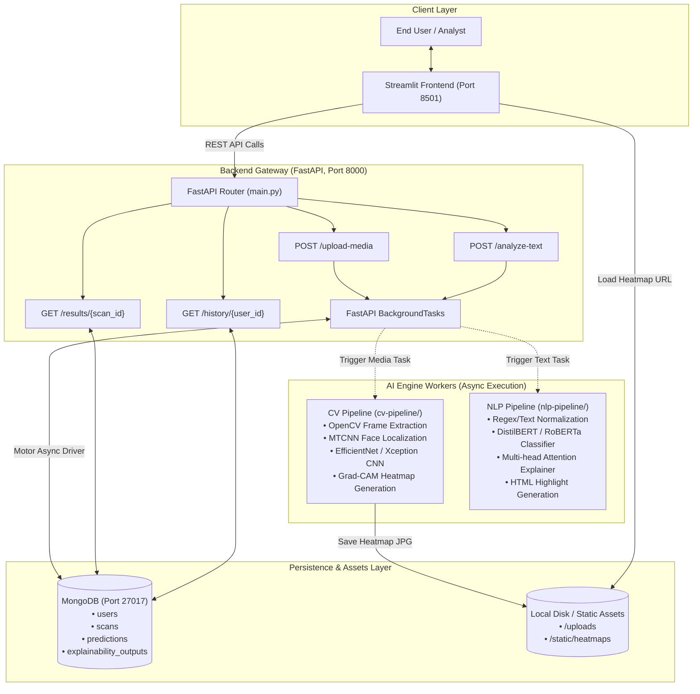
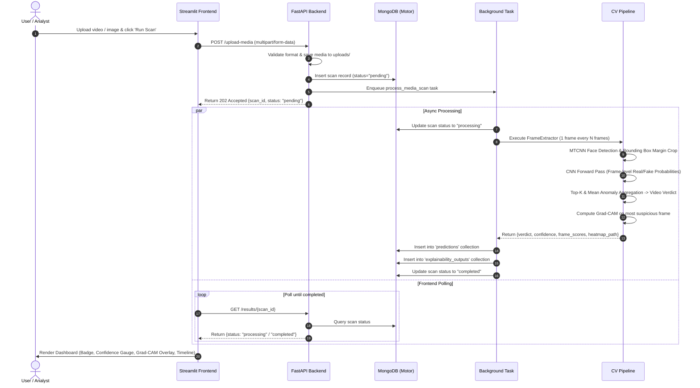
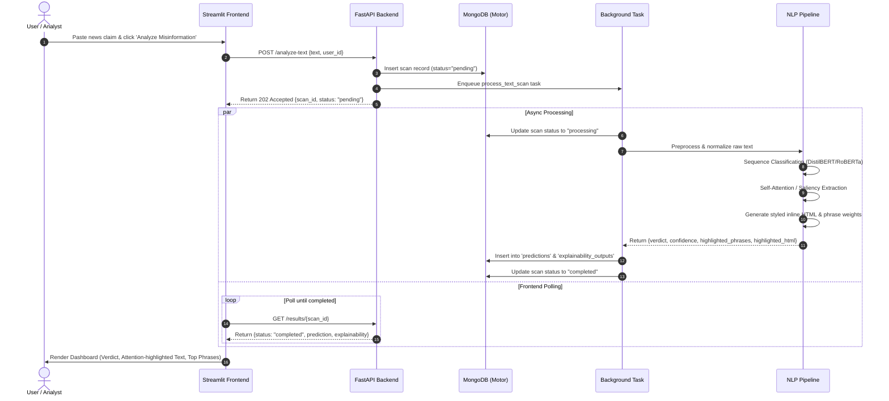

# TruthLens — System Architecture & Data Flow

This document details the multi-tiered architecture, database models, and execution lifecycle of **TruthLens** — an AI-powered platform for deepfake and misinformation detection.

---

## 🏛️ High-Level System Architecture



---

## 🔄 End-to-End Sequence Workflows

### 1. Media Deepfake Analysis Workflow



---

### 2. Text Misinformation Analysis Workflow



---

## 🗄️ Database Schema (MongoDB via Motor)

### 1. `scans` Collection
Tracks the lifecycle of media or text analysis requests.
```json
{
  "_id": "ObjectId('...')",
  "scan_id": "scan_a1b2c3d4e5",
  "user_id": "alice_analyst",
  "scan_type": "media",              // "media" | "text"
  "media_type": "video",             // "video" | "image" (if scan_type is media)
  "filename": "sample_speech.mp4",
  "saved_filepath": "/app/backend/uploads/scan_a1b2c3d4e5_speech.mp4",
  "text_claim": null,
  "text_preview": null,
  "status": "completed",             // "pending" | "processing" | "completed" | "failed"
  "label": "FAKE",
  "confidence": 0.892,
  "created_at": "2026-09-27T10:00:00.000Z",
  "updated_at": "2026-09-27T10:00:04.250Z",
  "error_message": null
}
```

### 2. `predictions` Collection
Stores the model outputs and frame-level statistics.
```json
{
  "_id": "ObjectId('...')",
  "prediction_id": "pred_scan_a1b2c3d4e5",
  "scan_id": "scan_a1b2c3d4e5",
  "model_name": "TruthLens-EFFICIENTNET_B0-MTCNN",
  "label": "FAKE",
  "confidence": 0.892,
  "frame_scores": [
    {
      "frame_index": 0,
      "timestamp_sec": 0.0,
      "label": "FAKE",
      "confidence": 0.912,
      "fake_probability": 0.912,
      "bbox": [120, 80, 240, 210]
    },
    {
      "frame_index": 15,
      "timestamp_sec": 0.5,
      "label": "FAKE",
      "confidence": 0.874,
      "fake_probability": 0.874,
      "bbox": [122, 82, 242, 212]
    }
  ],
  "summary": "Analyzed 12 frames: 10 flagged as suspicious, 2 authentic. Overall verdict: FAKE (89.2% confidence).",
  "completed_at": "2026-09-27T10:00:04.250Z"
}
```

### 3. `explainability_outputs` Collection
Contains visual heatmaps and phrase highlights.
```json
{
  "_id": "ObjectId('...')",
  "explainability_id": "exp_scan_a1b2c3d4e5",
  "prediction_id": "pred_scan_a1b2c3d4e5",
  "scan_id": "scan_a1b2c3d4e5",
  "type": "gradcam_heatmap",         // "gradcam_heatmap" | "text_highlight"
  "heatmap_url": "/static/heatmaps/heatmap_scan_a1b2c3d4e5.jpg",
  "heatmap_path": "/app/backend/static/heatmaps/heatmap_scan_a1b2c3d4e5.jpg",
  "highlighted_phrases": [],
  "highlighted_html": null,
  "token_importances": []
}
```

### 4. `users` Collection
Stores profile metadata and scan volume.
```json
{
  "_id": "ObjectId('...')",
  "user_id": "alice_analyst",
  "username": "Alice (Fact Checker)",
  "created_at": "2026-09-27T09:00:00.000Z",
  "last_active": "2026-09-27T10:00:04.250Z",
  "scan_count": 8
}
```
